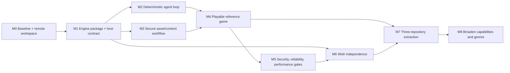

> Historical audit snapshot: findings below describe the Mac checkout observed on 2026-10-16. The current canonical roadmap and product boundaries are in [docs/roadmap/roadmap.md](../docs/roadmap/roadmap.md) and [docs/decisions.md](../docs/decisions.md).

# Ahamkara Engine Restart Roadmap

**Purpose:** strategic sequence and testable exit gates for resuming Ahamkara development after the audit.
**Date:** 2026-10-16 (America/Chicago).
**Basis:** the audited worktree at `b705d74`, the current uncommitted checkout, the specialist reports in this directory, the accepted product split in [`docs/architecture/repository-split.md`](../docs/architecture/repository-split.md), and the existing strategic roadmap in [`docs/roadmap/roadmap.md`](../docs/roadmap/roadmap.md).

> This document describes direction and milestone gates. It is not the active work queue. Per [`docs/AGENTS.md`](../docs/AGENTS.md), GitHub Issues own implementation status, priority, dependencies, and acceptance criteria. The audit backlog in [`02-BACKLOG.md`](02-BACKLOG.md) is a proposed decomposition, not proof that those tasks are already tracked. The repository roadmap points to architecture initiative [#61](https://github.com/tfq26/Project-Ahamkara/issues/61); verify its current scope before using it as the execution parent.

## Executive recommendation

Resume development by making one path reliable from **remote checkout → clean build → supported game module → asset load → deterministic play → machine-readable verification → visible frame**. Then use that path to build one short, playable 3D arena encounter. This turns the engine's current collection of useful subsystems into something a fresh AI agent can operate and verify.

Keep the accepted destination of three independently buildable products: Ahamkara (engine), Flashback (game), and Wish (session/backend platform). Do not extract the repositories first. The accepted split plan requires proving internal boundaries, package contracts, and out-of-tree consumers before history-preserving extraction. Build those proofs inside the monorepo, then move code once the consumer contracts work.

The first demonstrator should be a small 3D arena defense because the repository already has a first-person game direction, 3D renderer, movement, combat, AI, and shooter assets. Require one human playtest as well as an automated state/replay check. After the shared authoring workflow works, use a second, smaller game to test that the APIs are not merely Flashback-specific. Decide explicitly whether that second game requires first-class 2D rendering.

The order is deliberate:

1. Preserve and identify a baseline; provision the chosen remote development host.
2. Prove Ahamkara can be consumed as an engine package through a documented host contract.
3. Give agents a deterministic observe/act/replay and screenshot loop.
4. Make asset import secure, discoverable, loadable, and verifiable.
5. Build and playtest a complete reference encounter using the supported path.
6. Harden unattended execution, authentication, diagnostics, and performance gates.
7. Make Wish independent, then pass the extraction gates for three repositories.
8. Broaden genres and engine capabilities only through the correct product owner.

## How this roadmap uses existing direction

| Existing source | Direction retained here | How it changes sequencing |
|---|---|---|
| [`docs/roadmap/roadmap.md`](../docs/roadmap/roadmap.md) | Five strategic stages: trust the baseline; make Ahamkara a real engine; make Flashback a real game; make Wish independent; grow capabilities through the right owner. | This roadmap keeps those stages and expands them into nine evidence-based milestones. |
| [`docs/architecture/repository-split.md`](../docs/architecture/repository-split.md) | Ahamkara, Flashback, and Wish are distinct repositories/projects; consumer dependencies must be versioned artifacts. | Repository extraction is a late migration gate, after independent configure/build/test/package and out-of-tree consumer checks pass. |
| Extraction Gate 1 in repository-split | Ahamkara configures without game/client/server/Wish/Flashback sample; Wish builds without Ahamkara/Flashback types; Flashback uses a real module contract. | Included as a prerequisite for extraction, not assumed complete from CMake target options alone. |
| Extraction Gate 2 in repository-split | Namespaced packages, package configs, out-of-tree consumers, and Debug/Release/headless validation. | Package/consumer fixtures are required before splitting. |
| Extraction Gate 3 in repository-split | Preserve Git history, create product-specific CI/docs/issues/releases, and remove product folders only after external builds pass. | Extraction is performed last and requires a rollback/compatibility plan. |
| Audit reports `01–12` | Generic game-authoring interface, deterministic agent feedback, asset flow, gameplay closure, security, docs, testing, performance and dirty-baseline limitations. | M1–M5 supply the missing product loop before repository extraction or capability expansion. |
| Owner's remote-development preference and SSH inspection (2026-10-16) | Keep source/build outputs on a server and use Mac as the remote client. | M0 includes a remote workspace/toolchain gate. Use the large `/home` filesystem for repository and build trees; avoid filling the system SSD with build products. |

## Current baseline and constraints

These are observations, not assumptions about the clean committed revision. Reconfirm them after selecting a baseline.

| Area | Observed state | Planning consequence |
|---|---|---|
| Source baseline | Checkout at `b705d74`, with extensive pre-existing uncommitted changes. The recon's exact initial status count was disputed by the red-team review. | Do not clean, reset, or rebase this checkout to manufacture a baseline. Select a commit and worktree explicitly before implementation. |
| Build evidence | Cached-dependency headless configure succeeded in temporary output; current dirty-tree build failed linking a UI test while client/UI was disabled. CTest reported 67/71 passing; one dirty asset assertion, restricted socket tests, and an unavailable test binary affected the result. | Re-run from a clean isolated checkout. Do not label these dirty-tree results as a clean-HEAD regression. |
| Product boundaries | Engine, Flashback game/client, Wish/server, tools, and web projects are in one repository. Existing docs accept a three-product destination and require package proof before extraction. | Preserve the monorepo as a proving ground; move only after gates pass. |
| Public game contract | `IGameModule` provides lifecycle/tick behavior but not a complete game-facing input/entity/render/asset/audio contract. | Design the smallest reusable host-services contract around a real consumer sample. |
| AI loop | Dev MCP controls one existing client; agent-level reset/replay is absent. Screenshot/state capture did not complete in the audit environment. | Build a deterministic headless contract first and validate visible capture in a separate graphical lane. |
| Game/content proof | Asset import can copy/compile supported inputs, but import success does not establish runtime lookup/display. No complete fun game was playtested. | Prove asset-to-screen and one playable encounter before claiming a general workflow. |
| `servdesktop02` | SSH inspection found Ubuntu 26.04 LTS, Ryzen 5 5500 (12 logical CPUs), 14 GiB reported RAM, GTX 1050 Ti (4 GiB), CMake/Ninja absent from SSH PATH. Root filesystem is 218 GB; after Plane worktree/image cleanup it had 91 GB free. | Validate this host against the repo's compiler/dependency requirements. Put checkout, build, dependency caches, and large generated artifacts under `/home`, which has about 900 GB free. The GUI streaming path and Codex remote-host integration still need an end-to-end check. |
| Priority/source of truth | Repo docs say GitHub Issues own active work state; strategic docs do not become a local issue mirror. | Keep this roadmap stable; translate selected slices into issues before implementation. |
| Owner constraints | First target platform, 2D scope, timeline, and personal definition of fun were left unspecified in the audit template. | Use reversible defaults below; record owner decisions before widening scope or publishing support claims. |

## Product north star and ownership rules

The success condition is: an AI agent can start from a short game idea, author a small game through supported text/API surfaces, build it on the remote host, run deterministic scenarios, inspect structured state and logs, capture a frame, and iterate without a human manually repairing the routine workflow.

| Product | Owns | Must not own |
|---|---|---|
| **Ahamkara engine** | Core/runtime, generic host services, platform/input/render/audio/animation/physics/collision, generic networking, asset formats/import APIs, engine tools, examples, SDK, engine tests, diagnostics and profiling. | Flashback weapons, game modes, product maps, branding, Wish concepts, or product-specific game rules. |
| **Flashback game** | Player/world rules, weapons, abilities, NPC/game AI, encounters, progression, presentation, game-specific client/server composition, content, assets, levels, product configuration, automated playtest scenarios, and adapters to engine/service APIs. | Private engine implementation dependencies or sibling-source include paths after package gates. |
| **Wish platform** | Identity/authentication, sessions, admission, parties, matchmaking/activity lifecycle, service replication envelopes, operations/admin surfaces, backend adapters, and a game-neutral SDK/protocol. | Flashback command/snapshot types or engine internals. |

Dependency direction: Flashback consumes released Ahamkara and Wish artifacts. Ahamkara and Wish expose versioned contracts. Flashback owns translations between its game state and service contracts. Product code must not leak down into either reusable product.

## Milestone dependency map

M2 and M3 may proceed in parallel after M1's supported module/package seam is stable. M4 depends on both. Work involving unattended untrusted agent execution is blocked until M5's isolation/security exit criteria are met, even if the local reference game is already playable.

## Milestones

Effort ranges are planning estimates only. No calendar dates are assigned because the owner has not specified a deadline or available weekly capacity. Exit criteria are gates: if a gate fails, fix the gate before advancing the dependent milestone.

### M0 — Trust the baseline and prepare the remote workspace

**Maps to:** existing strategic Stage 1, “Trust the baseline.”
**Why first:** current local changes and audit test outcomes are not attributable to a clean baseline. The owner wants development and storage on a server, and the inspected server currently lacks CMake/Ninja in its SSH PATH.

**Workstreams**

- Record selected commit/branch and preserve the existing dirty checkout. Create an isolated clean worktree for baseline validation.
- Choose the development host. Current pragmatic default is `servdesktop02` for source/assets/builds under `/home`; verify CMake, Ninja, supported compiler, OpenGL/window stack, and dependency installation there. Keep the Mac as a remote client.
- Attach/configure Codex and other coding tools to the same server-side checkout model. Use one writer per branch/worktree. Keep GUI streaming as a separate presentation channel from the remote terminal/editor.
- Move or create repository, CMake build directories, package caches, and large temporary artifacts under the 900-GB `/home` filesystem. Monitor the 218-GB root/system disk separately.
- Run configure/build/test and web install/build on the selected clean baseline. Classify environment-dependent network/socket/UI tests separately from product failures.
- Repair root agent instructions through their authoritative generator/source; update false repo maps only after confirming the chosen baseline.

**Exit criteria**

1. The baseline SHA and disposition of the dirty working tree are recorded; no source files are discarded.
2. A fresh checkout on the remote host configures and builds at least the supported Debug and headless configurations with documented commands.
3. CTest produces a complete result with each skip/failure attributed to a reproducible code issue or a named environment limitation.
4. CMake/Ninja/compiler/dependencies are available in noninteractive SSH/agent sessions, not only an interactive shell.
5. The repository and build output reside on `/home`; a sample build leaves the root SSD's free-space floor above an owner-selected threshold.
6. Codex can open the remote repository and run commands there; a second tool can use the same Git remote/branch workflow without copying source to the Mac.
7. Root onboarding docs contain no unresolved placeholders, and documented presets match the build graph.

**Demonstration:** a clean remote checkout builds headless and graphical targets, tests report reproducibly, and Codex can edit/build from the server while the Mac stores no working copy or generated build tree.

**Included audit work:** `TASK-001`–`TASK-003`.
**Effort:** M.
**Do not advance if:** the selected baseline is unclear, the existing dirty tree was lost, or the remote environment works only through an interactive session.

### M1 — Make Ahamkara a consumable engine product

**Maps to:** existing strategic Stage 2, “Make Ahamkara a real engine product.”
**Why now:** the architecture is split across modules, but a module type alone is not a usable game-development contract. Package boundaries must be proven before source extraction.

**Workstreams**

- Define a versioned host-services contract for game lifecycle, fixed tick, input, entity/scene lifecycle, render submission, asset resolution, audio, diagnostics, and deterministic tests. Specify ownership, threading, lifetimes, error reporting, and compatibility policy.
- Keep the public API small. Start with one square/game module; add no service without a sample or integration test demonstrating it.
- Make engine-only configure/build/install independent of `game/`, `client/`, `server/`, `wish/`, and `samples/flashback/` source paths.
- Fix exported namespaced CMake targets and transitive include/link dependencies. An out-of-tree consumer must not manually inject the engine module path or private include paths.
- Resolve render/animation dependency direction and the ECS/world ownership rules at the public boundary. Do not move Flashback types into the engine to make a sample compile.
- Publish a minimal package config, compatibility/version policy, and a public-header/API index.
- Create one minimal moving-square sample in the supported example location. It should exercise input, fixed tick, render submission, and diagnostics through the public seam.

**Exit criteria**

1. A clean engine-only build and install succeeds without game, client, server, Wish, or Flashback sample sources.
2. An out-of-tree CMake consumer configures, builds, and runs using only installed/exported targets.
3. The sample displays a square and moves it from input; no Flashback-only headers or private target names are required.
4. Public API version, threading/ownership/lifetime, errors, and deprecation rules are documented and enforced by a consumer contract test.
5. Dependency direction is acyclic across core/runtime, skeleton/animation/render, and product service adapters; CMake's public links match the docs.
6. A fresh agent following the quickstart can make one behavior change and build the sample without undocumented setup fixes.

**Demonstration:** the moving-square app built from a temp consumer directory and a versioned package, with its source and complete setup written as readable text.

**Included audit work:** `TASK-004`–`TASK-007`.
**Effort:** L.
**Do not advance if:** the sample builds only inside the monorepo or reaches into Flashback/client internals.

### M2 — Add a deterministic agent observe/act/replay loop

**Maps to:** AI-first engine acceptance within strategic Stage 2.
**Why now:** agents need a closed feedback loop before they can efficiently author games. The current Game MCP is useful for controlling the existing client but does not prove a general game workflow.

**Workstreams**

- Create a headless runner for a supported sample/game module. It must boot, advance exact fixed ticks, accept a seed, collect logs/errors, and terminate on a frame/time budget.
- Define a stable structured state schema and deterministic state hash. Keep product-specific state in Flashback adapters; the generic runner should not expose private shooter structs.
- Add command IDs, accepted/rejected responses, and the exact tick at which an action applies. Reject malformed actions with actionable text rather than silently dropping them.
- Add deterministic scenario reset, input recording, and replay. Identify the first mismatching tick and state field on divergence.
- Add a graphical screenshot lane. It should launch the actual sample in a known display-capable session, verify bridge readiness, capture a frame, and store image + state + logs as artifacts.
- Keep mutation/control tools opt-in and dev-only. Do not enable unattended arbitrary native code until M5 worker isolation is done.
- Exercise one valid input, one invalid input, one replay, one win assertion, and one capture in CI.

**Exit criteria**

1. A headless scenario runs N fixed ticks without a display or wall-clock-dependent simulation step.
2. Replaying a seed/input trace in a fresh process yields the same state hash in 10 repeated runs on the supported baseline.
3. Every command returns a unique ID, validation result, and applied tick; observers can request a state snapshot correlated to that ID.
4. Reset restores the initial state; replay divergence reports tick and field, not merely a final boolean.
5. Graphical CI verifies a ready signal and produces a non-empty screenshot with a matching structured state artifact.
6. Errors, logs, and timeouts are machine-readable and name the next diagnostic step.
7. The same interface can operate both the moving-square sample and the Flashback test adapter without creating a second incompatible control protocol.

**Demonstration:** an agent runs a seeded scenario, moves the square/player, observes state, resets, reproduces the result, and retrieves a screenshot with no human clicking through the game.

**Included audit work:** `TASK-008`–`TASK-011`.
**Effort:** L.
**Do not advance if:** only the specialized client MCP path works or state output cannot be deterministically reproduced.

### M3 — Secure and complete the asset/content workflow

**Maps to:** Ahamkara tools and content-format ownership in strategic Stage 2.
**Why now:** importing a file is not the same as resolving it in a game. The pipeline is a core AI workflow and an exposed input boundary.

**Workstreams**

- Define a text-based project/scene/asset manifest with stable IDs, clear source/output roots, metadata schemas, and version compatibility.
- Confine manifest paths and imported glTF external URIs to approved roots. Reject absolute paths, traversal, symlink escapes, unsupported schemes, aliasing, and overwrite outside the destination.
- Bound parser bytes, recursive depth, buffer counts, texture dimensions, multiplication, total allocations, and per-asset time. Convert parser exceptions into stable errors.
- Decide the first content target: 3D model/material/level path for M4; explicitly decide whether 2D sprite/tilemap is in the initial engine scope. If 2D is in scope, implement sprite metadata, runtime resolution, scaling/origin/filter behavior, and render validation.
- Demonstrate a package reader that loads assets from a different current working directory using stable ID. A registry must not be only a report written by the importer.
- Add missing/invalid asset diagnostics, deterministic import outputs, and an explicit no-op/replace policy for import.
- Make asset validation and runtime hot reload scope explicit; do not claim all compiled content hot reloads if only menus/HUD do.

**Exit criteria**

1. A fresh manifest imports deterministically into a package; package opens from a different working directory and resolves asset IDs.
2. A valid model/texture (and sprite if 2D is in-scope) appears in the reference app and is covered by a screenshot or rendered-output assertion.
3. Adversarial traversal, symlink, malformed glTF, oversized texture, integer-overflow, and missing-file fixtures are rejected without writes outside the test root or process crash.
4. Every import warning/error identifies manifest entry, asset ID/path, cause, and repair action.
5. Metadata validation catches supported dimensions/format problems before runtime; test asserts clear rejection text.
6. Audio/event mappings and sound asset lifecycle have one documented mapping between game event and engine audio asset ID.
7. Runtime package compatibility and versioning is written down before shipping artifacts.

**Demonstration:** add one generated asset, validate/import it, load it by stable ID, render it in the sample, and capture the result in CI.

**Included audit work:** `TASK-012`–`TASK-015`.
**Effort:** L.
**Do not advance if:** a file copies successfully but cannot be loaded/rendered through a public runtime API, or untrusted paths can escape project roots.

### M4 — Ship one playable, testable Flashback reference slice

**Maps to:** existing strategic Stage 3, “Make Flashback a real game product.”
**Why now:** engine APIs should be judged against an actual game, not a catalog of features or a lifecycle-only module. This is the forcing function for game-feel and integration.

**Recommended first game:** single-room 3D arena defense, one player, one weapon, one enemy archetype, a few cover pieces, a short defend/kill objective, score, and win/lose/restart feedback. Use Flashback-owned rules and assets; Ahamkara supplies reusable engine services. Do not require multiplayer for the first slice.

**Workstreams**

- Compose player input, collision-aware movement, camera, one weapon, enemy spawn/navigation/combat, encounter triggers, score, end state, and restart.
- Fix only the gameplay integration gaps needed for the slice: trigger dispatch, objective closure, simultaneous wave completion, collision-respecting NPC path following, config validation, and relevant animation contact/rotation behavior.
- Give the player clear feedback: UI objective/score, hit feedback, sound, readable enemy state, and a visible success/failure transition.
- Define a deterministic bot or scripted input trace that completes the encounter and one trace that intentionally fails.
- Use the M2 headless contract for state assertions and M3 package import/load for authored assets. Keep human playtesting as a separate acceptance signal.
- Record a short playtest script and collect player friction, completion rate, run duration, and top confusion; fix the top blocking issue before declaring the slice a reference game.

**Exit criteria**

1. Clean build launches into a playable encounter with no manual console commands or hidden flags.
2. Player can start, move, aim, use the weapon, take damage, defeat the enemy/wave, see score/outcome, and restart.
3. NPCs cannot cross a test wall; objective/wave closure waits for actual enemy defeat; unreachable paths fail visibly.
4. Deterministic test bot passes a success trace and a failure trace; score and win/loss match expected structured state.
5. At least one human unfamiliar with implementation can identify the goal, complete a run, and provide recorded feedback; no unresolved blocker remains.
6. Screenshot/state/log artifacts come from a clean CI run and from the remote graphical session.
7. The game module and assets consume public package surfaces; the engine package has no Flashback gameplay concepts.

**Demonstration:** a 3–8 minute arena loop a human can finish and an AI can replay, verify, and visually inspect.

**Included audit work:** `TASK-016`–`TASK-018`, with relevant `TASK-006`, `TASK-008`, `TASK-010`, and `TASK-014` prerequisites.
**Effort:** XL.
**Do not advance if:** tests pass only by asserting internal data while the visible loop is broken, or “fun” is claimed without a playtest.

### M5 — Harden security, reliability, and performance for agent use

**Maps to:** cross-cutting gates for strategic Stages 2–4.
**Why now:** after the loop works locally, make it safe for unattended execution and dependable enough to preserve the owner's machine and data.

**Workstreams**

- Threat model AI tasks. Treat generated C++ and user-supplied assets/manifests as untrusted for unattended workers. Until isolation exists, document trusted-local-only execution.
- Restrict worker process environment, filesystem mounts, network access, process tree, memory, CPU, and wall-clock duration. Worktrees isolate Git changes only; they are not an OS sandbox.
- Fix asset path and parser hardening from M3. Bind admin endpoints to private addresses/authenticated routes and replace long-lived credential transmission over HTTP/UDP with secure short-lived tickets or authenticated encryption. Disable unsafe production paths until fixed.
- Replace non-signal-safe crash handling work with safe capture/helper processing; implement or clearly scope Windows crash reporting.
- Wire CPU profiler sampling into real frame stages. Set release-like budgets using representative game workloads, not only debug microbenchmarks. Keep streaming retained-state bounds measured against target map sizes.
- Treat remote hosting as infrastructure: secure Tailscale/SSH access; store builds in `/home`; monitor root disk, Docker images/build cache, and journald growth; set retention limits rather than deleting data reactively.
- Add dependency pin/provenance/SBOM and online vulnerability scan in CI when network-enabled CI is available. Current CVE status remains unknown until a real scan runs.

**Exit criteria**

1. Worker cannot read a host sentinel secret, write outside its mount, access blocked network targets, or survive its configured timeout.
2. No reusable Nakama bearer token appears in cleartext HTTP/UDP test captures; public admin endpoints reject unauthorized requests or bind only to loopback/private interface.
3. Importer traversal/symlink and parser resource-limit tests pass; failures occur before outside-root writes or unbounded allocations.
4. POSIX crash handler avoids allocation, filesystem I/O, locks, logging, and symbol resolution inside signal context. Windows support is implemented or expressly unsupported.
5. Profiler yields non-zero stage samples in the reference game; representative release-like benchmarks identify hardware/workload and maintain declared frame/memory budgets.
6. Streaming registry memory and lookup scale are measured with expected maximum world coordinates; severity follows measurement, not speculation.
7. Dependency scanning reports exact manifests/versions, SBOM artifact, and disposition of findings; moving source references are pinned or explicitly justified.
8. Security/privacy documentation discloses opt-in frame/state transfer to external QA providers and offers a local/no-upload path where practical.

**Demonstration:** CI runs the reference game in a restricted worker, records a replay/capture, reports its performance budget, and emits dependency/security artifacts.

**Included audit work:** `TASK-019`–`TASK-022`; additional findings SEC-004/008/009 and PERF-003/004 need issue decomposition.
**Effort:** L.
**Gate condition:** no unattended untrusted native game code runs before item 1 is passed.

### M6 — Make Wish an independent, game-neutral product

**Maps to:** existing strategic Stage 4, “Make Wish a real independent product.”
**Why now:** engine and game product boundaries are easier to separate once public packages and one consumer game prove the boundaries.

**Workstreams**

- Remove Ahamkara/Flashback source includes and game-specific command/snapshot types from Wish session runtime.
- Define versioned Wish identity, admission, session, activity, replication-envelope, and service SDK contracts. Keep game-specific serialization/translation in Flashback adapters.
- Secure auth and service transport before exposing credentials to real deployments; ensure authentication is fail-closed outside explicit development mode.
- Give Wish its own configure/build/test/package flow and fixtures with no sibling source path.
- Keep the native server composition game-neutral; Flashback should own its dedicated-server activity/router adapters.

**Exit criteria**

1. Wish configures/builds/tests/packages from an isolated checkout without Ahamkara or Flashback source/include paths.
2. Wish public headers contain only Wish-owned or declared dependency types; no Flashback packet/command/snapshot type is imported.
3. A game-neutral fixture exercises admission, session lifecycle, activity routing, and serialization compatibility.
4. Authentication fails closed by default and production credential transport meets M5 security criteria.
5. Flashback consumes only versioned Wish protocol/SDK artifacts and owns all game-state translation.
6. Wish CI and docs can operate without relying on root CMake options or sibling directory conventions.

**Demonstration:** isolated Wish release artifact is consumed by the Flashback fixture and an out-of-tree service integration example.

**Existing roadmap reference:** Wish Stage 4 and repository-split Gates 1–2 in [`docs/roadmap/roadmap.md`](../docs/roadmap/roadmap.md) and [`docs/architecture/repository-split.md`](../docs/architecture/repository-split.md).
**Effort:** L–XL.
**Execution tracking:** coordinate with architecture initiative #61; verify current issue scope and dependencies first.

### M7 — Pass the three-repository extraction gates

**Maps to:** accepted destination and history-preserving extraction in [`docs/architecture/repository-split.md`](../docs/architecture/repository-split.md).
**Why now:** extraction before proven package boundaries would turn hidden include/link coupling into three failing repositories. This is a migration milestone, not a source-code cleanup shortcut.

**Gate 1 — internal boundaries**

- Ahamkara configures without `game/`, `client/`, `server/`, `wish/`, or `samples/flashback/` source.
- Wish configures without Ahamkara private paths or Flashback types.
- Flashback implements the versioned game-module contract and no longer calls a monolithic shared client entry point.
- Cross-boundary dependencies are represented by explicit producer-owned APIs/adapters.

**Gate 2 — packages and CI**

- Ahamkara exports namespaced package targets/config; Wish exports an independent SDK/protocol package.
- Out-of-tree consumer fixtures use installed/published artifacts only.
- Debug, Release, headless, and package install/consumer tests pass from clean checkouts.
- Flashback locks exact compatible Ahamkara and Wish release versions and has its own local/dedicated-server smoke tests.
- Breaking API/protocol changes are versioned with compatibility notes and migration tests.

**Gate 3 — history-preserving extraction**

- Agree on repository names, remotes, default branches, issue templates, CI ownership, docs landing pages, secrets/deployment policy, release automation, version tags, and maintainers.
- Extract the engine, Flashback game, and Wish product with relevant history. Do not remove monorepo folders until the extracted builds and smoke tests pass from the new remotes.
- Keep a rollback window: tagged pre-extraction state, migration manifest, package versions, cross-repo commit mapping, and documented revert procedure.
- After consumers are verified, remove extracted product folders from Ahamkara. Move product-specific docs/assets/tests with their owners; leave public-contract docs only in Ahamkara/Wish.

**Exit criteria**

1. All Gate 1 and Gate 2 checks pass in isolated CI jobs before any history split.
2. The extraction plan maps each source directory, test, asset, docs page, CI workflow, and deployment setting to one owner.
3. History/branch extraction is verified by checking representative commit ancestry and tags in each destination.
4. Ahamkara and Wish package releases are published; Flashback builds using those exact releases from a clean checkout.
5. Rollback can restore the previous monorepo product set and package versions without losing changes.
6. The separate repositories each have a maintainable README, agent guide, build/test gate, release process, and issue workflow.

**Demonstration:** three clean repositories independently build, test, and package; Flashback consumes released Ahamkara/Wish artifacts and passes the reference-game scenario.

**Effort:** XL.
**Do not advance if:** extraction requires relative sibling paths, private headers, hand-copied artifacts, or undocumented local environment state.

### M8 — Grow capabilities through the correct owner

**Maps to:** existing strategic Stage 5, “Grow capabilities through the correct owner.”
**Why last:** after one game proves the contract and product boundaries, feature work can expand without entangling engine, game, and service ownership.

**Ahamkara-owned capability candidates**

- General 2D sprite/tilemap if owner chooses 2D as first-class.
- Mature 3D rendering, material/shader pipeline, post-processing, renderer/backend abstraction, GPU timing and frame capture.
- General animation, physics/collision, streaming, input, UI, audio, platform support, and safe hot reload.
- Text-based level/scene authoring and schema validation; package registry discoverability.
- Versioned save/snapshot primitives, determinism policy, performance budgets and cross-platform diagnostics.

**Flashback-owned capability candidates**

- Weapon/content breadth, encounter pacing, NPC tactics, progression/economy, difficulty tuning, accessibility and onboarding.
- Production levels, campaign/match flows, player-facing saves, game balance, and multiplayer game rules.
- Human playtesting and automated bot scenarios that assert win/loss and measure run outcomes.

**Wish-owned capability candidates**

- Game-neutral identity, sessions, parties, matchmaking, activity lifecycle, replication, service SDKs, admin/operations and deployment.
- Secure authentication/credential rotation and operational reliability, tested independently of Flashback.

**Exit criteria**

1. Every new feature has an explicit product owner and a public contract if another product consumes it.
2. Two reference games use the same Ahamkara boot/input/asset/state/replay/capture contract. The second game may be top-down only after the 2D decision is made.
3. New game rules remain in Flashback; generic systems remain in Ahamkara; backend/social/session concerns remain in Wish.
4. Each shipped capability has one of: automated unit/integration/visual test, measured budget, or documented manual playtest procedure.
5. Capability claims in docs match tested status; no feature is called implemented based solely on a struct/schema/stub or unconnected pass.

**Demonstration:** a second game in a different genre is authored mostly through shared, documented Ahamkara APIs without engine-internal edits for routine game rules.

**Included audit work:** `TASK-023` plus future issues from specialist findings not yet decomposed.
**Effort:** L per genre/capability slice.

## Cross-milestone release gates

These gates apply at each milestone, not only at the end.

| Gate | Minimum bar |
|---|---|
| Baseline | Every conclusion references a commit/worktree; no destructive cleanup of user state is used to create a false clean result. |
| API | Public contract has a sample consumer, version/lifetime/error rules, and no private sibling include dependency. |
| Build | Build output goes to the server's `/home` workspace; clean Debug/headless result is repeatable; Release/package path is exercised before release claims. |
| Tests | Tests validate the boundary being claimed. Headless tests are distinguished from graphical tests; environment-only failures are classified. |
| AI operation | Agent actions have IDs/results/ticks; state is structured; replay is reproducible; screenshots are captured through the intended launched runtime. |
| Assets | Import validates paths and sizes; package reader resolves by ID; failed imports produce actionable diagnostics. |
| Security | No unattended native execution without OS isolation; real credentials do not pass through plaintext HTTP/UDP paths; remote screenshots/data transfer is disclosed. |
| Design | “Fun” requires human playtest evidence and a game that starts, has a clear objective, ends, and can restart. |
| Documentation | Every command is run on the selected baseline; docs describe the supported workflow, not only an architectural intention. |
| Ownership | Cross-product changes begin with a producer contract update and consumer adapter change; GitHub Issues track execution. |

## Measures of progress

Track these measures in test/CI artifacts or product playtest notes. They are outcome metrics for roadmap gates, not daily status fields in this document.

| Measure | Baseline from audit | Target before claiming the milestone |
|---|---|---|
| Cold-start path from clean clone to sample running | No reproducible generic path; scratch module needed manual CMake setup. | One documented setup path on remote host; sample builds and launches without source-tree surgery. |
| Agent task completeness | Five experiments did not produce a rendered game or engine-managed state capture. | Agent completes add behavior, add/display asset, score/win, replay, and screenshot with machine-verifiable result. |
| Replay determinism | Internal prediction/replay pieces exist; no agent-facing scenario contract. | Identical state hash for repeated seeded runs; divergence includes first tick/field. |
| Asset-to-visible time | Import-only sprite copy was verified; runtime sprite display was not. | Time from asset generation/import to visible sample result measured and documented. |
| Boot/run reliability | Dirty build/test; MCP launch did not reach ready in audit environment. | CI boot readiness and bounded-run success tracked across repeated runs. |
| Playtest outcome | No complete game or fun assessment was verified. | At least one recorded playtest per reference game with completion/friction feedback. |
| Security | Parser/path/network/worker risks identified; CVE audit unverified. | Threat-model test suite passes; dependency/SBOM output exists; credentials excluded from cleartext paths. |
| Performance | No workload measurements; profiler runtime sampling incomplete. | Release-like frame/memory budgets measured on named hardware and run in CI. |
| Remote environment | `servdesktop02` reachable; CMake/Ninja missing from SSH PATH; large `/home` volume available. | CMake/Ninja and build dependencies work in agent sessions; source/build remain on remote `/home`; GUI stream validation captured. |

## What to defer or avoid

- Do not add weapon/character/mode catalogs before the vertical slice can be completed and replayed.
- Do not split repositories before Gate 1/2 package proofs. A directory split that still needs sibling paths does not meet the accepted destination.
- Do not redesign the renderer, ECS, or scripting model globally before the M1 sample identifies the minimum usable contract.
- Do not build a large GUI editor before text-based, diffable scene/asset formats and their runtime validators work.
- Do not claim general sprite/tilemap support from UI quads or import passthrough.
- Do not call internal rollback “deterministic replay for agents” until seeded scenario reset/action/state replay is public and tested.
- Do not automatically execute generated native code with the host's credentials, home directory, unrestricted network, or unlimited resources.
- Do not tune frame-time claims without a representative workload and measurements on a named target.
- Do not remove auth/TLS/protection or widen admin services to make a demo easier.
- Do not move Wish concepts into the engine or Flashback gameplay into Ahamkara to solve short-term compile friction.
- Do not store active task status, priority, or dependencies in this roadmap; use GitHub Issues.

## Decisions to record before their gates

| Decision | Recommended default | Decision deadline | Tradeoff |
|---|---|---|---|
| Baseline/dirty checkout disposition | Preserve the current checkout; choose a clean commit/worktree for M0; do not discard local work. | Before any source change | Current branch, `b705d74`, and newer `origin/main` have different states; silent choice makes results untrustworthy. |
| Remote development host | Start with `servdesktop02` if Codex/other tools can attach reliably; keep repo/build on `/home`; use a separate GUI stream for the game. | M0 | Known CPU/GPU and ample `/home`; CMake/Ninja and Codex integration need setup. `servlenovo1` has the existing Coder path but hardware was not inspected. |
| Authoring form | Text project/scene/asset/objective manifests plus typed C++ extension points. | M1 | All-C++ is flexible but opaque and unsafe to execute unattended; a full DSL is more declarative but a larger first project. |
| Native code trust model | Treat agent-generated code as untrusted in unattended runs; sandbox before enabling. | Before M2 mutation beyond owner-controlled local use | In-process C++ is simple, but has host process privileges. |
| First supported platform | Pick one CI-supported desktop target for the reference game; keep headless engine checks on available OS CI. | M1 | Broad platform claims increase graphical/runtime setup and screenshot variance. |
| First genre | 3D arena defense/FPS as the first forcing function. | M1 | Matches existing renderer/game path; does not prove API generality by itself. |
| 2D support | Decide whether 2D is first-class before M3 sprite work. | M3 | Implement sprite/tilemap now or explicitly document a 3D-first initial release. |
| Renderer verification | Structured state assertions plus screenshot artifacts in CI. | M2 | Adds display-capable CI work but is needed to verify visual results autonomously. |
| Save/load | Versioned scenario snapshot/reset first; player-facing progression saves later. | M2/M4 | Replay needs stable state serialization; persistent saves add migration/compatibility needs. |
| Repository extraction | History-preserving split only after all accepted gates pass. | M7 | Early split exposes hidden dependencies; late split postpones product ownership clarity. |
| Wish transport/auth | Disable unsafe real credential paths until secure transport or short-lived tickets are ready. | Before external/production use | Secure transport is work; plaintext credentials create avoidable exposure. |
| Dependency policy | Immutable refs, reproducible lockfiles, scheduled SBOM/vulnerability review. | M0/M5 | More pin updates, but reproducible security posture. |

## Handoff to execution

1. Preserve this roadmap and the rest of `/audit/`; do not treat the audit backlog as completed issue tracking.
2. Ask the owner to select the source baseline and confirm `servdesktop02` as the remote build host.
3. Verify the authoritative state of GitHub Issue #61 and create/refresh the M0 issues beneath the appropriate initiative.
4. Complete M0 before editing engine source. Record exact configure/build/test commands and artifact paths.
5. At every gate, compare the actual implementation and tests to the listed exit criteria. Do not advance by schedule alone.
6. Keep the accepted three-product direction and the AI-native success condition visible in design decisions, API reviews, and release checks.
